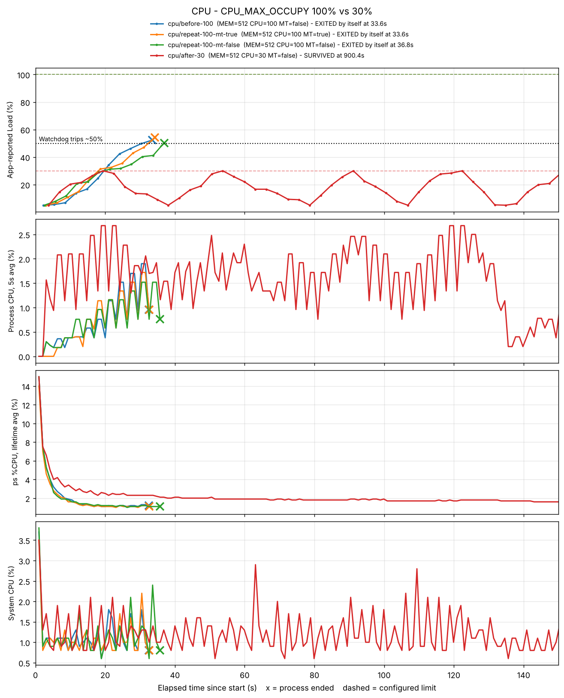

# [Bug] CPU Latency - CpuWorker 부하가 상한 없이 증가해 Watchdog(약 50%)에 의해 SIGTERM 종료

| 항목 | 내용 |
|---|---|
| 심각도 | High — 실행 33~37초 만에 서비스 중단, 3회 실행 3회 재현 |
| 환경 | Ubuntu 22.04 컨테이너 (OrbStack, linux/amd64, 6 core, 16GB), 실행 계정 `agent`(uid 1000) |
| 재현 조건 | `CPU_MAX_OCCUPY=100` (메모리 `512`, 스레드 `false`로 다른 장애는 배제) |
| 증거 | [`evidence/cpu/before-100/`](../evidence/cpu/before-100/) · 재현 [`repeat-100-mt-true`](../evidence/cpu/repeat-100-mt-true/) · [`repeat-100-mt-false`](../evidence/cpu/repeat-100-mt-false/) · After [`after-30`](../evidence/cpu/after-30/) |

## 1. Description (현상 설명)

- **언제**: 2026-11-05 09:40:17 실행 → **09:40:50 (33.6초 후)** 종료
- **무엇이**: `agent-leak-app`(부모 PID 56891 / 앱 본체 PID 56897)이 종료됨
- **어떻게 관측됐나**: 앱의 `[CpuWorker] Current Load`가 3초마다 5% → 52%까지 쉬지 않고 오르다가 `CPU Threshold Violated! (52.33%)` 직후 프로세스가 사라짐. 종료 코드 143(SIGTERM)
- **재현성**: 같은 조건(CPU 100) 3회 실행 모두 33.6초 / 33.6초 / 36.8초에 같은 방식으로 종료
- **범위**: 같은 시간 시스템 전체 CPU는 1~2%로 평탄 → **서버 전체 과부하가 아니라 이 프로세스 내부 문제**

## 2. Evidence & Logs (증거 자료)

### 2-1. 프로그램 실행 로그 — 부하 증가와 종료

```
 [ CPU    ] Limit: 100%  		[ WARNING: Recommend Under 50% ]
2026-11-05 09:40:19,268 [INFO] [CpuWorker] Started. Maximum CPU Limit: 100%
2026-11-05 09:40:19,269 [INFO] [CpuWorker] Current Load: 5.00%
2026-11-05 09:40:28,618 [INFO] [CpuWorker] Current Load: 13.74%
2026-11-05 09:40:34,874 [INFO] [CpuWorker] Current Load: 24.44%
2026-11-05 09:40:41,103 [INFO] [CpuWorker] Current Load: 42.30%
2026-11-05 09:40:47,346 [INFO] [CpuWorker] Current Load: 49.74%
2026-11-05 09:40:50,464 [INFO] [CpuWorker] Current Load: 52.33%
2026-11-05 09:40:50,566 [CRITICAL] [CpuWorker] CPU Threshold Violated! (52.33%).
```

재현 실행의 마지막 줄:

```
[repeat-100-mt-true ] 2026-11-05 09:41:56,318 [CRITICAL] [CpuWorker] CPU Threshold Violated! (54.23%).
[repeat-100-mt-false] 2026-11-05 09:44:31,987 [CRITICAL] [CpuWorker] CPU Threshold Violated! (50.3%).
```

→ 세 번 모두 **50%를 처음 넘은 직후** 종료. `CPU_MAX_OCCUPY=100`으로 줬는데도 50%에서 끊겼으므로, 종료 기준은 설정값이 아니라 **앱에 고정된 약 50% 임계치**(부팅 경고 `Recommend Under 50%`와 일치)다.

### 2-2. 종료 형태 (`summary.txt`)

```
survival_s  : 33.6
end_reason  : EXITED by itself (exit code 143) = signal 15 (TERM)
```

- 종료 코드 143 = 128 + 15 → **SIGTERM**. 미션 예시의 `WATCHDOG ... SIGTERM` 문구는 이 빌드 로그에 찍히지 않았지만, `Threshold Violated` 0.1초 뒤 SIGTERM으로 끝났다는 사실이 종료 코드로 확인된다.
- 크래시라면 Python Traceback이나 SIGSEGV(139)/SIGABRT(134)가 나왔어야 한다 → **오류가 아니라 의도된 보호 조치**.

### 2-3. 관제 데이터 — 앱 지표 vs OS 측정값



| 구간 | 앱이 보고한 Load | OS 측정 프로세스 CPU (10초 평균) | `ps %CPU` | 시스템 CPU |
|---|---|---|---|---|
| 0~10초 | 5% → 7% | 0.31% | 7.5% → 2.0% | 1~3% |
| 10~20초 | 14% → 24% | 0.53% | 1.5% → 1.2% | 1% 안팎 |
| 20~34초 | 34% → 52% | **1.32%** | 1.2% → 1.3% | 1~2% |

```
[2026-11-05 09:40:28] PROCESS:agent-leak-app PID:56891,56897 ... CPU:1.0% ... SYS_CPU:1.3% LOAD:0.01
[2026-11-05 09:40:47] PROCESS:agent-leak-app PID:56891,56897 ... CPU:4.8% ... SYS_CPU:1.8% LOAD:0.01
[2026-11-05 09:40:50] END  reason=EXITED by itself (exit code 143) = signal 15 (TERM)
```

관찰한 사실 세 가지:

1. **OS가 잰 프로세스 CPU도 앱 Load와 같은 방향으로 증가했다** (10초 평균 0.31 → 0.53 → 1.32%, 약 4배). 3회 실행 모두 같은 추세. 다만 절대값은 6코어 중 코어 1개의 2% 미만으로 작다.
2. **`ps %CPU`는 증가를 전혀 보여주지 못했다.** `ps`는 "프로세스 시작 이후 누적 평균"이라 초반 기동 비용(15%)이 희석되며 계속 떨어지기만 했다. `ps`만 봤다면 "CPU 문제 아님"으로 오판했을 것이다. 그래서 `monitor.sh`는 `/proc/<pid>/stat` tick 증가량으로 순간값을 직접 계산한다.
3. **살아남은 After 실행(30%)이 실제 CPU는 더 많이 썼다** (평균 1.5~2.1%). After 실행에서는 메모리 워커와 스케줄러 작업도 함께 돌기 때문이다. 즉 **Watchdog은 OS가 측정한 CPU가 아니라 앱 내부의 Load 지표로 판단한다.** 이 앱의 CpuWorker는 부하를 시뮬레이션하는 구조로 보이며, 리포트의 "CPU 급상승"은 앱 지표 기준이다.

### 2-4. 프로세스 우선순위 (`top -H` 스냅샷)

```
    PID USER      PR  NI    VIRT    RES    SHR S  %CPU  %MEM     TIME+ COMMAND
   2105 agent     30  10  170172  18032   9436 S   0.0   0.1   0:00.05 agent-l+
```

앱은 부팅 시 `[SafetyGuard] Process priority lowered (nice=10)`로 **스스로 우선순위를 낮춘다** (`NI 10`, `PR 30`). CPU를 많이 쓰더라도 다른 프로세스가 먼저 스케줄링되도록 한 1차 방어선이고, Watchdog은 2차 방어선이다.

## 3. Root Cause Analysis (원인 분석)

### 증거 → 원인

1. **Load가 3초마다 단조 증가하고 내려오지 않음** → CpuWorker가 작업량을 계속 늘리기만 하는 구조. `CPU_MAX_OCCUPY=100`이 "최대 100%까지 올려도 된다"는 상한으로 쓰여, 사실상 **브레이크가 없는 상태**
2. **약 50%를 넘는 순간 SIGTERM** (3회 모두) → 앱 내부 Watchdog의 고정 임계치. 설정 상한(100)이 Watchdog 임계치(50)보다 높아 **반드시 Watchdog에 걸리는 설정 충돌**
3. **After(30%)에서는 Load가 30%에 닿으면 `Peak reached (30.00%). Starting cooldown...` → 5%까지 내려간 뒤 다시 증가** → `CPU_MAX_OCCUPY`는 Watchdog 기준이 아니라 **작업이 스스로 멈추는 상한(throttle)** 이라는 것이 확인됨

정리하면: 상한(`CPU_MAX_OCCUPY`)을 Watchdog 임계치(50%)보다 높게 주면 부하가 임계치를 뚫고 올라가 강제 종료되고, 임계치보다 낮게 주면 작업이 먼저 스스로 식혀서 살아남는다.

### 관련 OS 동작 원리

- **CPU 스케줄링과 타임 슬라이스**: 리눅스 CFS 스케줄러는 실행 가능한(`R`) 태스크들에게 CPU 시간을 나눠준다. I/O나 sleep 없이 계산만 하는 태스크는 자기 몫을 매번 꽉 채워 쓰고 바로 다시 대기열에 선다.
- **과점유가 지연(Latency)을 만드는 원리**: 코어 수보다 실행 대기 태스크가 많아지면 다른 서비스는 대기열에서 기다리는 시간이 늘어난다. 웹 요청 응답, SSH 입력이 느려지는 것이 이 때문이며, `load average`가 코어 수를 넘으면 대기 중인 태스크가 있다는 뜻이다.
- **nice 값**: nice가 클수록 CFS에서 받는 가중치가 줄어 CPU를 덜 배정받는다. 이 앱의 `nice=10`은 다른 프로세스와 경쟁할 때 양보하도록 만든 장치다.
- **단일 프로세스 종료가 시스템 보호인 이유**: 과점유의 피해는 원인 프로세스가 아니라 **같은 서버의 다른 서비스**가 입는다. 원인 하나를 끊는 비용(그 작업 실패)이 모든 서비스가 느려지는 비용보다 작다. 그리고 SIGKILL이 아닌 **SIGTERM**을 써서 정리(파일 닫기, 연결 종료)할 기회를 준다.

## 4. Workaround & Verification (조치 및 검증)

### 조치: `CPU_MAX_OCCUPY` 100 → 30 (Watchdog 임계치 50% 아래로)

```bash
# Before
MEMORY_LIMIT=512 MULTI_THREAD_ENABLE=false CPU_MAX_OCCUPY=100 ./scripts/monitor.sh cpu before-100
# After
MEMORY_LIMIT=512 MULTI_THREAD_ENABLE=false CPU_MAX_OCCUPY=30  ./scripts/monitor.sh cpu after-30
```

### Before & After

| 항목 | Before (`CPU_MAX_OCCUPY=100`) | After (`CPU_MAX_OCCUPY=30`) |
|---|---|---|
| 부팅 판단 | `WARNING: Recommend Under 50%` | `[ OK ]` |
| 앱 Load 최대 | 52.33% (임계치 돌파) | 30.00% (상한에서 멈춤) |
| 상한 도달 시 동작 | 계속 증가 → `Threshold Violated` | `Peak reached → cooldown → 5%까지 하강 → 재증가` |
| 상한 도달 횟수 | - | 25회 (약 35초 주기) |
| 생존 시간 | **33.6초** (재현 33.6 / 36.8초) | **900초 이상** (관제 타임아웃까지 생존) |
| 종료 사유 | SIGTERM (exit 143) | 관제가 정상 종료 |

### 해석

- `CPU_MAX_OCCUPY`를 **낮추는 것**이 조치였다. 처음에는 "한도를 올리면 덜 죽을 것"이라고 생각해 30을 Before, 100을 After로 실행했는데 결과가 반대로 나왔고, 로그의 `Recommend Under 50%`, `Peak reached`, `cooldown`을 보고 의미를 바로잡았다.
- 대가: 작업이 30%에서 멈추고 식히기를 반복하므로 **처리량은 줄어든다**. 시스템 안정성과 작업 속도를 맞바꾼 임시 조치다.

### 근본 해결 제안

- 무거운 계산을 작은 단위로 쪼개고 사이에 `sleep`/양보를 넣어 부하를 평탄화, busy-wait 루프를 이벤트·조건변수 대기로 교체
- 작업 큐 + 처리량 제한(rate limit)으로 부하가 스스로 올라가지 않게 설계
- 앱 내부 Watchdog에만 의존하지 말고 OS 수준 상한도 이중으로: cgroup `cpu.max`(컨테이너면 `docker run --cpus`), `systemd`의 `CPUQuota=`
- 설정 검증: 상한이 Watchdog 임계치보다 높으면 부팅 단계에서 거부하거나 자동 보정 (지금은 경고만 출력)
