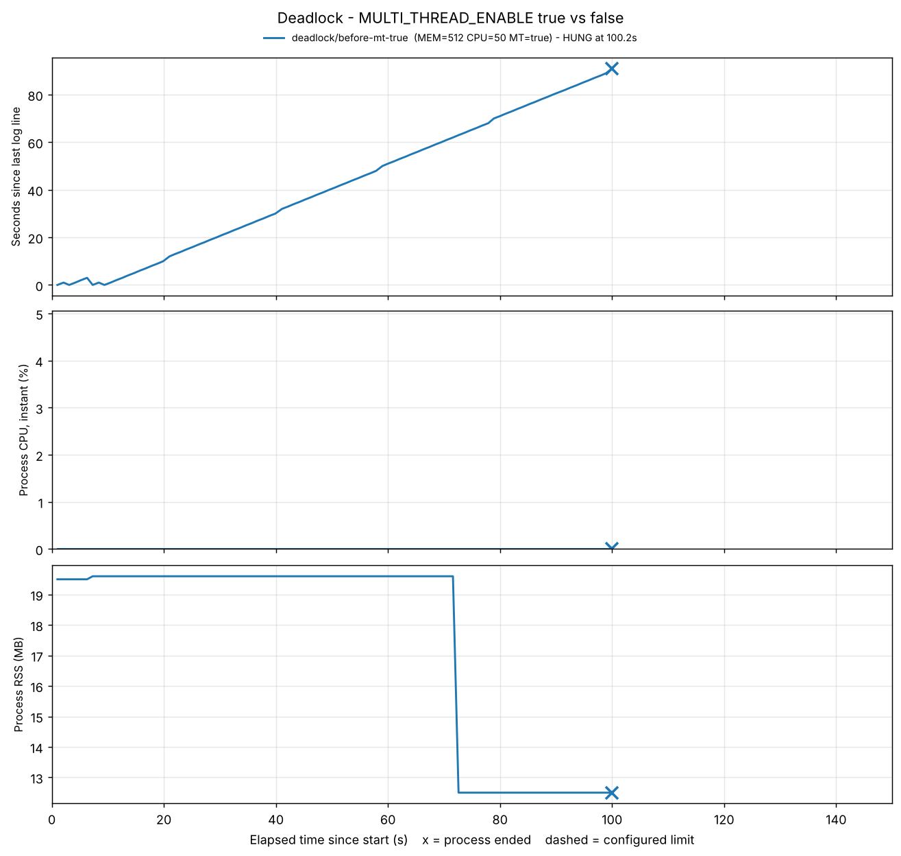

# [Bug] Deadlock - 멀티스레드 환경에서 교착상태 발생으로 프로세스 무응답

> 상태: 🟡 초안 — `<!-- TODO -->` 부분은 실측 데이터로 채움
> 증거 폴더: [`evidence/deadlock/`](../evidence/deadlock/)

## 1. Description (현상 설명)

- **무엇이**: `agent-leak-app`이 종료되지 않고 PID는 그대로 살아있는데, 아무 일도 하지 않는 무응답 상태가 됨
- **언제**: 실행 후 약 <!-- TODO -->초, `MULTI_THREAD_ENABLE=true` 조건
- **어떻게 관측됐나**: 로그 출력이 <!-- TODO -->초 이상 멈추고, CPU 0% 근처 · 메모리 변화 없음. 크래시처럼 "꺼진" 게 아니라 "멈춘" 상태라 겉으로는 정상처럼 보임 → 오히려 OOM/CPU보다 발견이 어려운 장애

## 2. Evidence & Logs (증거 자료)

### 2-1. PID 존재 증거

```
<!-- TODO: evidence/deadlock/before-mt-true/snapshots/*stall-detected.txt 의 ps -ef | grep 결과 -->
```

### 2-2. CPU/MEM 정체 증거



```
<!-- TODO: monitor.log 에서 LOG_IDLE 이 계속 늘어나고 CPU 0%, RSS 고정인 구간 발췌 -->
```

### 2-3. 스레드 상태 (`ps -L` / `top -H`)

```
<!-- TODO: snapshots/*stall-detected.txt 의 ps -L 결과 -->
```

- 모든 스레드 상태가 `S`(Sleeping) — 실행(`R`)도 종료도 아님
- `WCHAN`(커널에서 무엇을 기다리는지)이 `futex_*` → **futex = 리눅스에서 mutex/lock 대기를 구현하는 시스템 콜**. 즉 스레드들이 전부 **락을 얻기 위해 잠들어 있음**
- `top -H`에서 스레드별 CPU 0.0%, TIME+ 증가 없음 → 스핀(busy-wait)이 아니라 블로킹 대기

### 2-4. 마지막 로그 지점

```
<!-- TODO: app.log 마지막 줄들 (WAITING ... BLOCKED) -->
```

## 3. Root Cause Analysis (원인 분석)

### 마지막 로그로 대기 관계 추론

<!-- TODO: 실제 로그에 맞춰 스레드/자원 이름 수정 -->

| 스레드 | 보유 중인 자원 | 기다리는 자원 |
|---|---|---|
| Thread A | Lock 1 | Lock 2 |
| Thread B | Lock 2 | Lock 1 |

```
 Thread A ──(보유)──▶ Lock 1
    ▲                    │
 (대기)               (대기)
    │                    ▼
 Lock 2 ◀──(보유)── Thread B
```

A는 B가 가진 자원을, B는 A가 가진 자원을 기다림 → 대기 그래프에 **사이클** → 둘 다 영원히 깨어나지 못함.

### 교착상태 4대 조건 대입

| 조건 | 이 장애에서 |
|---|---|
| 상호 배제 (Mutual Exclusion) | 락은 한 번에 한 스레드만 보유 가능 |
| 점유 대기 (Hold and Wait) | 자기 락을 놓지 않은 채 다른 락을 요청 |
| 비선점 (No Preemption) | 다른 스레드의 락을 강제로 빼앗을 수 없음 |
| 순환 대기 (Circular Wait) | A→B→A 순환 (위 그래프) |

네 조건이 **모두** 성립하므로 교착상태가 발생한다. 하나라도 깨면 발생하지 않는다.

### 왜 OS가 알아서 해결하지 못하나

스레드들이 `S` 상태로 잠들어 있으니 스케줄러 입장에서는 "기다리는 중인 정상 스레드"일 뿐이다. CPU도 안 쓰고 에러도 안 나므로 OS·Watchdog·MemoryGuard 어느 것도 반응하지 않는다. 그래서 **로그 정지 시간(LOG_IDLE)** 같은 "진행 여부" 지표로만 감지할 수 있다 (식사하는 철학자 문제에서 모두가 왼쪽 포크를 들고 오른쪽을 기다리는 상황과 같다).

## 4. Workaround & Verification (조치 및 검증)

```bash
MULTI_THREAD_ENABLE=true  ./scripts/monitor.sh deadlock before-mt-true 300
MULTI_THREAD_ENABLE=false ./scripts/monitor.sh deadlock after-mt-false 300
```

| 항목 | Before (`true`) | After (`false`) |
|---|---|---|
| 스레드 수 | <!-- TODO --> | <!-- TODO --> |
| 로그 진행 | <!-- TODO: N초 후 정지 --> | <!-- TODO: 계속 출력 --> |
| 결과 (summary end_reason) | <!-- TODO: HUNG --> | <!-- TODO: SURVIVED --> |

**해석**: 단일 스레드로 돌리면 락을 두고 경쟁할 상대가 없어서 **순환 대기 조건이 원천적으로 사라짐** → 데드락 회피. 대신 병렬 처리 이점을 잃어 처리량이 줄어드는 트레이드오프.

### 근본 해결 제안

- **락 획득 순서 통일**: 모든 스레드가 항상 Lock 1 → Lock 2 순서로만 잡으면 순환 대기가 생길 수 없음
- **타임아웃 락**: `lock.acquire(timeout=…)` 실패 시 보유 락을 반납하고 재시도 (점유 대기 깨기)
- **락 범위 최소화 / 단일 락으로 통합**
- 운영 감시: 로그·하트비트가 N초 이상 멈추면 알람 (이 레포의 `monitor.sh` STALL 감지처럼)
