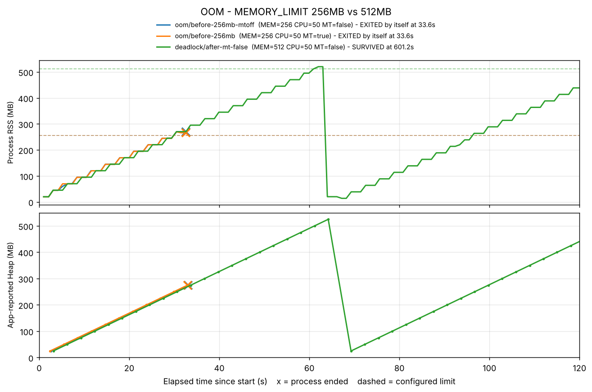

# [Bug] OOM - Heap 누수로 MEMORY_LIMIT(256MB) 도달 시 MemoryGuard에 의한 강제 종료

| 항목 | 내용 |
|---|---|
| 심각도 | High — 실행 33초 만에 서비스 중단, 2회 실행 2회 재현 (생존 시간 동일) |
| 환경 | Ubuntu 22.04 컨테이너 (OrbStack, linux/amd64, 6 core, 16GB), 실행 계정 `agent`(uid 1000) |
| 재현 조건 | `MEMORY_LIMIT=256 CPU_MAX_OCCUPY=50` (`MULTI_THREAD_ENABLE` true/false 무관) |
| 증거 | Before [`oom/before-256mb-mtoff/`](../evidence/oom/before-256mb-mtoff/) · 재현 [`oom/before-256mb/`](../evidence/oom/before-256mb/) · After [`deadlock/after-mt-false/`](../evidence/deadlock/after-mt-false/) |

> §1~§2의 로그 발췌는 첫 실행(`oom/before-256mb`)에서 가져왔습니다. 두 번째 실행(`before-256mb-mtoff`)은 시각·PID만 다르고 증가 속도·종료 시점·로그 내용이 같습니다 (§2-3 표).

## 1. Description (현상 설명)

- **언제**: 2026-11-05 09:10:36 실행 → **09:11:08 (33.6초 후)** 종료
- **무엇이**: `agent-leak-app` 프로세스(부모 PID 279 / 앱 본체 PID 285)가 사용자 조작 없이 사라짐
- **어떻게 관측됐나**: 관제상 물리 메모리(RSS)가 19.8MB에서 일정한 계단 모양으로 계속 오르다 266MB에서 기록이 끊김. 앱 로그 마지막 줄은 `[MemoryGuard] Self-terminating process 285`
- **특징**: 에러·예외(Traceback) 없이 종료. CPU는 내내 1% 안팎으로 조용함 → 겉으로는 "멀쩡히 돌다가 갑자기 꺼진" 장애

## 2. Evidence & Logs (증거 자료)

### 2-1. 관제 데이터 — RSS 선형 증가 (`monitor.log`)

```
[2026-11-05 09:10:37] PROCESS:agent-leak-app PID:279,285 STATE:SS THREADS:2 CPU:0.0% MEM:0.12% RSS:19.8MB  SYS_CPU:3.5% ...
[2026-11-05 09:10:45] PROCESS:agent-leak-app PID:279,285 STATE:SS THREADS:2 CPU:0.0% MEM:0.59% RSS:94.8MB  SYS_CPU:1.0% ...
[2026-11-05 09:10:56] PROCESS:agent-leak-app PID:279,285 STATE:SS THREADS:2 CPU:0.0% MEM:1.06% RSS:169.8MB SYS_CPU:1.0% ...
[2026-11-05 09:11:08] PROCESS:agent-leak-app PID:279,285 STATE:SS THREADS:2 CPU:0.0% MEM:1.66% RSS:266.1MB SYS_CPU:0.8% ...
[2026-11-05 09:11:09] END  reason=EXITED by itself (exit code 137) = signal 9 (KILL)
```

| 경과 | RSS (관제) | Heap (앱 로그) |
|---|---|---|
| 1초 | 19.8MB | - |
| 9초 | 94.8MB | 75MB |
| 20초 | 169.8MB | 150MB |
| 32초 | 266.1MB | 250MB → 275MB |

- **증가율**: RSS 19.8 → 266.1MB / 약 30.5초 ≈ **8.1MB/s**, 앱 로그 기준 25MB / 3.05초 ≈ **8.2MB/s** → 두 독립 측정이 일치, **선형(일정 속도) 누수**
- RSS가 Heap보다 약 20MB 큰 것은 Python 런타임·라이브러리 자체 메모리(시작 시점 19.8MB)
- 같은 구간 CPU 1% 안팎, 시스템 CPU 1% 안팎 → **연산 문제가 아니라 메모리만 쌓이는 문제**



> 파랑·주황: 256MB 실행 2회 — 거의 겹친 채 한도(갈색 점선)를 넘자마자 ✕ 종료 / 초록: 512MB 실행 — 같은 속도로 늘다가 525MB에서 정리 후 다시 증가 (톱니 모양)

### 2-2. 프로그램 실행 로그 (종료 직전)

```
2026-11-05 09:10:36,389 [INFO] [SafetyGuard] Process priority lowered (nice=10).
 [ MEMORY ] Limit: 256MB 		[ WARNING: Recommend Over 256MB ]
2026-11-05 09:10:38,439 [INFO] [MemoryWorker] Current Heap: 25MB
2026-11-05 09:10:41,496 [INFO] [MemoryWorker] Current Heap: 50MB
   … (3.05초마다 +25MB) …
2026-11-05 09:11:05,932 [INFO] [MemoryWorker] Current Heap: 250MB
2026-11-05 09:11:08,956 [INFO] [MemoryWorker] Current Heap: 275MB
2026-11-05 09:11:08,957 [CRITICAL] [MemoryGuard] Memory limit exceeded (275MB >= 256MB) / (Recommend Over 256MB)
2026-11-05 09:11:08,957 [CRITICAL] [MemoryGuard] Self-terminating process 285 to prevent system instability.
```

### 2-3. 종료 형태 (`summary.txt`)

```
survival_s  : 33.6
end_reason  : EXITED by itself (exit code 137) = signal 9 (KILL)
peak_rss_mb : 269.8
```

- 종료 코드 137 = 128 + 9 → **SIGKILL**. 정리 기회를 주는 SIGTERM이 아니라 즉시 강제 종료
- 로그의 `process 285`는 관제가 잡은 자식 PID와 일치 → 부모(279, PyInstaller 압축 해제 프로세스)가 아니라 **앱 본체가 자기 자신을 종료**

**재현성 (2회 실행)**

| 실행 | MULTI_THREAD | 시작 → 종료 (UTC) | PID (부모/본체) | 생존 | 최대 RSS | 마지막 Heap | 종료 |
|---|---|---|---|---|---|---|---|
| `before-256mb` | true | 09:10:36 → 09:11:08 | 279 / 285 | 33.6초 | 269.8MB | 275MB | SIGKILL (137) |
| `before-256mb-mtoff` | false | 10:28:42 → 10:29:15 | 62523 / 62529 | 33.6초 | 270.0MB | 275MB | SIGKILL (137) |

스레드 설정을 바꿔도 결과가 완전히 같다 → 메모리 한도가 256 이하이면 앱은 다른 설정과 무관하게 누수 시나리오를 고른다.

## 3. Root Cause Analysis (원인 분석)

### 증거 → 원인

1. **RSS가 일정 간격·일정 크기(25MB/3초)로 증가하고 한 번도 줄지 않음** → 주기적으로 객체를 할당하고 참조를 놓지 않는 **Heap 누수**. Python은 참조가 남아 있는 객체를 GC가 회수하지 않으므로, 전역 리스트·캐시에 계속 쌓기만 하는 구조로 추정
2. **종료 직전 Heap(275MB)이 한도(256MB)를 처음 넘은 시점에 바로 종료** → 우연한 크래시가 아니라 **임계치 검사 후 의도적으로 실행되는 보호 로직**
3. **커널 메시지가 아니라 앱 로그(`[MemoryGuard]`)에 종료 사유가 기록됨** + 시스템 메모리 사용률은 1.66%에 불과 → 커널 OOM Killer(시스템 메모리 부족 시 발동)가 아니라 **애플리케이션 내부 정책**에 의한 자체 종료

### 관련 OS 동작 원리

- **프로세스 메모리 구조**: Code / Data / **Heap** / Stack. 실행 중 동적으로 만드는 객체(리스트, 버퍼, 캐시)는 Heap에 쌓인다. 해제되지 않은 Heap은 프로세스가 끝날 때까지 물리 메모리를 차지한다.
- **RSS vs VSZ**: VSZ는 예약만 한 가상 주소 공간까지 포함하지만, RSS는 **실제 RAM에 올라와 있는 페이지**만 센다. 누수된 데이터는 실제로 쓰인 페이지라 RSS가 같이 오른다 → 누수 판단은 RSS로.
- **누수가 시스템 전체에 미치는 영향**: 한 프로세스가 RAM을 계속 차지하면 → 다른 프로세스가 쓸 페이지 캐시 감소 → 스왑 발생(디스크 I/O로 시스템 전체 지연) → 결국 커널 **OOM Killer**가 `oom_score`가 높은 프로세스를 SIGKILL. 이때 누수와 무관한 DB·SSH가 희생될 수도 있다.
- **MemoryGuard가 프로세스를 죽이는 이유**: 위 연쇄가 시작되기 전에 **원인 프로세스 하나만** 먼저 끊는 안전 퓨즈. 이번에도 호스트 메모리 1.66% 시점에 끊어 다른 프로세스에는 영향이 없었다. 즉 **종료는 보호 동작이고, 결함은 누수 자체**다.

## 4. Workaround & Verification (조치 및 검증)

### 조치: `MEMORY_LIMIT` 256 → 512 상향

```bash
# Before
MEMORY_LIMIT=256 CPU_MAX_OCCUPY=50 MULTI_THREAD_ENABLE=false ./scripts/monitor.sh oom before-256mb-mtoff
# After (MEMORY_LIMIT만 변경)
MEMORY_LIMIT=512 CPU_MAX_OCCUPY=50 MULTI_THREAD_ENABLE=false ./scripts/monitor.sh deadlock after-mt-false 600
```

### Before & After

| 항목 | Before (256MB) | After (512MB) |
|---|---|---|
| 앱 판단 | `WARNING: Recommend Over 256MB` → 누수 시나리오 | `[ OK ]` → 정상 모드 |
| 생존 시간 | **33.6초** | **600초 이상** (관제 타임아웃 600초까지 생존) |
| 한도 도달 시 동작 | `MemoryGuard` 자체 종료 (SIGKILL) | `Memory Usage Reached Limit (525MB). Starting cleanup...` → `MEMORY RECOVERED (Cache Cleared)` |
| 한도 도달 횟수 | 1회 (즉시 종료) | 9회 (약 66초 주기로 정리 후 회복) |
| 누수 속도 | 25MB / 3.05초 | 25MB / 3.05초 (동일) |

> Before와 After는 `MEMORY_LIMIT`만 다르고 나머지 설정(CPU 50, 스레드 false)은 같습니다. 같은 512MB에서 CPU만 30으로 둔 15분 실행(`cpu/after-30`)도 13회 정리 후 생존해 같은 결과입니다.

### 해석

- **누수 속도는 그대로이고 한도와 대응 방식만 바뀌었다.** 512MB에서는 한도 도달 시 프로세스를 죽이는 대신 캐시를 비우는 경로로 가서 살아남았지만, Heap은 다시 0부터 같은 속도로 쌓인다(그래프 초록선의 톱니 모양).
- 따라서 이 조치는 **증상을 늦춘 임시 조치**다. 누수 속도가 일정하므로 생존 시간 ≈ (한도 − 초기 사용량) ÷ 누수 속도로 예측할 수 있다: 256MB → (256 − 0) ÷ 8.2 ≈ 31초 예상, 실측 33.6초.
- 실서비스라면 정리(flush) 순간 캐시가 비면서 응답 지연이나 데이터 유실이 생길 수 있고, 메모리 512MB를 항상 예약해야 하므로 비용도 커진다.

### 근본 해결 제안

- 쌓이는 자료구조에 상한 두기: `collections.deque(maxlen=N)`, `functools.lru_cache(maxsize=N)`, 또는 TTL 기반 만료
- 처리 끝난 데이터는 참조를 명시적으로 제거 (`del`, `list.pop`, `dict.clear`)
- 개발 단계에서 `tracemalloc`으로 할당 위치별 증가량을 비교해 누수 지점 특정
- 운영 관제는 절대값(80%) 알람보다 **증가 기울기**로 "한도까지 남은 시간"을 예측해 미리 경고 (README §7 참고)
